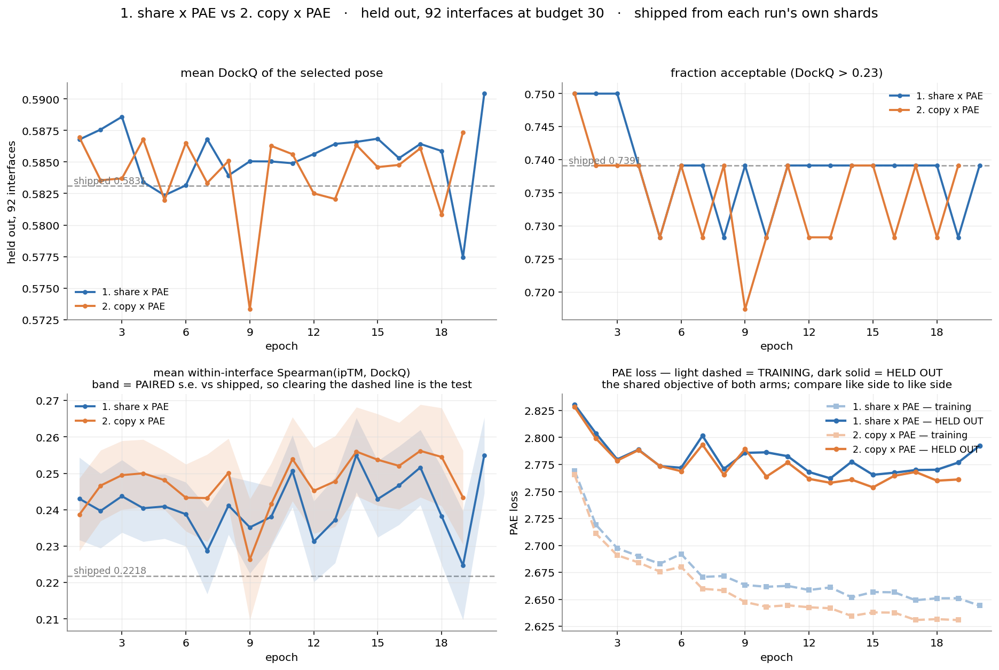

# Experiments overview

**Goal.** Beat Protenix's shipped confidence head at picking antibody–antigen poses, on
FoldBench/PXM interfaces, at **no more compute than a free 50-seed budget**. We re-run FT3
(confidence-head-only training) on our own pose distribution and re-score; the trunk is frozen and
never retrained.

The **Live results** section below is regenerated hourly from the shards by
`run_logging/experiments_doc.py` and pushed; everything outside its markers is written by hand.

---

## What is held constant across all three

Changing any of these makes two runs incomparable, so they are fixed:

| | |
|---|---|
| training pool | `full_train` — 487 structures × 10 seeds = 4,870 units |
| held-out pool | `valfull` — 92 interfaces, scored at budget 30 |
| objective | masked PAE only (`--pae-only --alpha-pae 1.0`), no ranking loss |
| optimiser | AdamW, lr 1e-2 **flat after 20 warmup steps** (`--lr-final 0.0` means NO decay) |
| crop | contact 5 Å, margin 15 Å, `--crop-size 3400` (never binds; max 1,581 tokens) |
| other | `--accum 85`, `--nsample 5`, seeds 500000–500009, `--blocks-per-ckpt 0` |
| horizon | 20 epochs |

**Shipped baseline on `valfull`**, recomputed from each run's own shard rows via `stored_iptm`
(never hardcoded): DockQ **0.5831**, frac acceptable **0.7391**, rho **0.2218**.
Oracle ceiling: DockQ 0.6926, frac 0.8587 → **headroom 0.1096**.

---

## Live results

<!-- AUTO:BEGIN -->



*Regenerated 2026-10-31 6:05 AM EDT. Every number below comes from each run's own train_eval shards and rank_rho cache; shipped is recomputed from the same rows via `stored_iptm`.*

Shipped on `valfull` (92 interfaces, budget 30): DockQ **0.5830**, frac **0.7391**, rho **0.2218**.

| # | run | epochs | DockQ | frac | rho | paired ΔDockQ (last) | train PAE | val PAE |
|---|---|---|---|---|---|---|---|---|
| 1 | `ip8ga4` | 1..20 | 0.5904 | 0.7391 | 0.2550 | +0.0074 ± 0.0040 | 2.6443 | 2.7923 |
| 2 | `dntxmn` | 1..20 | 0.5860 | 0.7283 | 0.2540 | +0.0030 ± 0.0032 | 2.6256 | 2.7770 |
| 3 | `tv6hue` | 1..20 | 0.5748 | 0.7391 | 0.2318 | -0.0082 ± 0.0054 | 2.6095 | 2.7444 |

- **1. share x PAE** (`ip8ga4`, 20 epochs): paired ΔDockQ mean **+0.0023**; rho 0.2550 (best 0.2551) vs shipped 0.2218; train PAE 2.7693 → 2.6443; val PAE 2.8305 → 2.7923, min 2.7621 at epoch 13.
- **2. copy x PAE** (`dntxmn`, 20 epochs): paired ΔDockQ mean **+0.0011**; rho 0.2540 (best 0.2562) vs shipped 0.2218; train PAE 2.7654 → 2.6256; val PAE 2.8283 → 2.7770, min 2.7538 at epoch 15.
- **3. full head + L2-SP 0.001** (`tv6hue`, 20 epochs): paired ΔDockQ mean **-0.0106**; rho 0.2318 (best 0.2519) vs shipped 0.2218; train PAE 2.7005 → 2.6095; val PAE 2.8207 → 2.7444, min 2.7174 at epoch 5.

<!-- AUTO:END -->

## The three experiments

All three inject pose identity at **4 pairformer blocks**. They differ only in how many weight
sets do the injecting, and in what the rest of the head is allowed to do.

| # | name | run id | pose weights | rest of head (246 tensors) | status |
|---|---|---|---|---|---|
| 1 | share × PAE | `j583i8` → `uhyypy` → `ip8ga4` | 1 set, shared by all 4 sites (block 0's own pretrained weights) — **0 new params** | **frozen** | done, 20 epochs |
| 2 | copy × PAE | `dntxmn` | 4 untied sets, each initialised from block 0 — **30,720 new params** | **frozen** | running, ep 14/20 |
| 3 | full head + pose-free L2-SP | queued | same 4 untied sets as #2 | **trainable, priced** at 1e-3·‖W−W_shipped‖² | starts ~6:15 PM Oct 26 |

Experiments 1 and 2 have **bit-identical step 0** — `install()` asserts the copies equal block 0
exactly — so capacity is the only variable between them. Experiment 3 is one variable off 2: the
same 8 pose tensors stay free, and the other 246 go from *frozen* to *trainable-but-priced*.

---

### 1. share × PAE — does pose conditioning help at all?

**Trains** 2 tensors / 10,240 params (0.052% of the head).

| | result |
|---|---|
| paired ΔDockQ | **+0.0023** mean over 20 epochs; +0.0074 ± 0.0040 at ep20 (t=1.84, its best) |
| paired Δrho | **+0.0193** mean, t>2 on 10 of 20 epochs |
| frac acceptable | **0.7391 at ep20 — exactly shipped**, and tied with shipped on 9 of the last 10 |
| train PAE | 2.7693 → 2.6443, still falling at ep20 |
| val PAE | 2.8305 → 2.7923, **min 2.7621 at ep13** then a noisy plateau and a clear rise at ep19–20 |

**Read.** It reshuffles roughly 40–55 of 92 interface selections and the wins and losses nearly
cancel. The ordering gain is real and the DockQ gain is marginal; **`frac_acceptable` never moved
off shipped**, which is the metric that matters for FoldBench. 6.8% of the DockQ headroom captured
at its single best epoch.

### 2. copy × PAE — is the tied injection the bottleneck?

**Trains** 8 tensors / 40,960 params. Fills a genuinely empty cell: all 30 prior runs using
`--pose-perblock-copy` carried the ranking loss, which was later shown to lower its loss by
*margin collapse* rather than by ordering, so copy had never been tried under PAE.

| | result through ep14 |
|---|---|
| paired ΔDockQ | +0.0008 mean; +0.0032 ± 0.0032 at ep14 |
| paired Δrho | **+0.0239** mean — ahead of share's +0.0184 over the same 14 epochs |
| frac acceptable | 0.7391 — shipped again |
| train PAE | 2.7654 → 2.6347 (below share at every matched epoch, 14/14) |
| val PAE | 2.8283 → 2.7609, **min 2.7580 at ep13** — the same minimum epoch as share |

**Read.** Untying helps the *ordering* more than the *argmax*: ahead of share on rho (t=+2.38 over
matched epochs) and behind on DockQ, with every gap near one s.e. But it wins train PAE by 2.4×
its val PAE margin, and its generalisation gap is wider than share's by **+0.0067 ± 0.0017,
wider in 11 of 12 matched epochs** — the extra parameters are being spent on train fit faster than
they transfer. Both arms bottom out at epoch 13 and dip together at epoch 9, which points at the
data order rather than the weights.

### 3. full head + pose-free L2-SP — capacity only where it is new

`--l2-sp 1e-3 --l2-sp-exclude 'linear_no_bias_d'`, no trainable restriction.

The exclusion is an unanchored regex, so it selects exactly the 8 tensors experiment 2 trained.
Those keep **no anchor at all**; the other 246 are anchored to the shipped weights at λ=1e-3.

**Why the pose tensors are excluded, measured not assumed.** By epoch 13 `dntxmn`'s 8 pose tensors
sat at ‖ΔW‖² = **120,392** over 40,960 parameters (RMS 1.714 per parameter) — `linear_no_bias_d`
starts with a tensor norm of 0.780 and travels 158 from it, 200× its own initial size. These are
being learned from near-nothing, not fine-tuned. Anchoring them at λ=1e-3 would charge **120
against a PAE loss of 2.64**, ~45× the objective, and the optimiser would spend its gradient
dragging them back instead of learning. No λ both regularises the 246 and leaves the pose part
functional. (That 1.714 RMS is from a run where the 8 tensors are the *only* thing moving, so in
this arm they will likely travel less — but the margin is wide enough that the conclusion holds.)

**Question.** Both earlier regimes failed in opposite ways. Letting all 254 tensors move freely
(`wpg274`, `ocqtyt`, `mdv9x7`, `eewbr5`) memorised the training set — the two longest runs ended
with val PAE *worse* than epoch 1 while train improved by 0.6. Freezing all but 8 stopped the
overfitting but barely improved anything. This is the middle: free where the head has something
new to learn, expensive where it already works.

**λ is not derived.** `l2sp_lambda.py`'s transfer formula is deliberately unused — see
[Known traps](#known-traps). λ=**1e-3** is a chosen value — lowered from 1e-2 before launch
because `wpg274`'s measured full-head drift of 3,801 priced at 1e-2 is 38.0 against a loss near
2.6, ~14× the objective and likely to pin the 246 outright, where 1e-3 prices it at 3.8 (~1.4×).
That is a reason, not a prediction. The arm is read on the **measured**
`l2-sp: ||W-W0||^2 = … penalty = …` line printed each epoch, against train and val PAE.

**First thing to check at launch.** The log must print
`8 tensor(s) stay TRAINABLE but are OUT of the anchor, 246 anchored`.
If it says 2, the pose copies are being anchored to their init and the arm is not what it claims.

**Open risk.** Full-head backward at 1,581 crop tokens *with* the pose injection has never been
run. `wpg274` did full-head backward at 1,473 tokens without injection (44.89 GB peak); `dntxmn`
does the injection at 1,581 tokens with a restricted backward (54.83 GB peak). This arm is both.
An OOM would surface inside epoch 1 and checkpointing is not available as a remedy.

---

## How to read the metrics

- **`frac_acceptable`** (DockQ > 0.23 on 92 interfaces) is the criterion. It has not moved off
  shipped in any arm.
- **paired ΔDockQ** is *algebraically identical* to mean DockQ minus the shipped line — the mean of
  the differences equals the difference of the means on the same interfaces. Pairing buys only the
  error bar, and that is the point: unpaired s.e. is ~0.05, paired is ~0.002.
- **rho** = mean *within-interface* Spearman(ipTM, DockQ), over all ~30 poses rather than the one
  argmax outcome. Within-interface, never pooled: pooled, an easy interface has both high ipTM and
  high DockQ, so the number would mostly measure which interfaces are easy.
- **PAE** train-vs-held-out is **not a clean generalisation gap** — different pools, and the
  held-out pass still crops. Compare like side to like side across arms.

## Known traps

1. **`val10` and `valfull` are never comparable.** 18 interfaces vs 92; one interface is 1/18 of
   the mean on val10 and `wpg274`'s paired s.e. there was ±0.0292.
2. **One interface dominates the noise.** `7zmk_WX` swings 0.73–0.78 DockQ in both arms and moves
   the 92-interface mean by ~0.008 by itself; the top five movers hold ~90% of the squared range,
   and 14–19 of 92 interfaces never change pick at all. Dropping `7zmk_WX` *halves* the error bars
   and leaves both arms' gains intact. **Single-epoch swings carry almost no signal** — read means
   over epochs, not individual epochs.
3. **`--lr-final 0.0` means NO decay**, not decay-to-zero. The gate is `if a.lr_final > 0.0`.
4. **Do not derive L2-SP λ from `l2sp_lambda.py`.** Its formula preserves *per-parameter* drift,
   which the file itself admits is not a claim about the function. On `wpg274` it produced λ=1e-5,
   whose penalty reached 0.0380 against a loss near 2.0 — under 2% of the objective — because it
   had been sized for an assumed drift of 67,052 when the drift that occurred was 3,801, 18×
   smaller. The λ was sized on a trajectory the λ itself prevented. Sweep and read the measured
   penalty instead.
5. **Shipped baselines are always recomputed** from the run's own `stored_iptm` rows. A hardcoded
   baseline has been a bug here before.

## Deferred

- **Held-out val PAE should run on uncropped input** (it currently crops to ~31% of the pair
  matrix while the DockQ eval does not). Fixing it also revives merging the two eval passes, which
  currently forward the same 7,950 poses twice — worth ~7 min/epoch. Groundwork is committed
  (`--emit-iptm-rows`, `run_logging/dockq_from_iptm.py`).
- **Linear within-seed ranking term** (`--rank-loss --alpha-rank <w>`, no `--rank-cross-seed`).
  Costs no extra forward pass: the linear form's gradient coefficients come from labels alone, and
  unlike the softplus form it cannot be gamed by margin collapse.
- **Two L2-SP λ arms on `overfit30`/`val10`** at 1e-3 and 1e-4, 15 epochs each — launchers exist
  (`launch_l2sp_1e3_overfit30.sh`, `launch_l2sp_1e4_overfit30.sh`) but are unqueued. They were the
  cheap read on what λ does to a full head; that time went to experiment 3 instead.

## Reproducing the figures

```
run_logging/plot_three.py <rid>                      # one arm vs shipped, spans the resume chain
run_logging/plot_arms.py ip8ga4=share dntxmn=copy \
    --out training/runs/share_vs_copy.png            # overlay; refuses mismatched pools
run_logging/paired_mean.py <rid> <lo> <hi>           # one number, computed one way
run_logging/crop_pose_equivalence.py                 # audits the pose-0 crop claim on all 4,870 units
```
