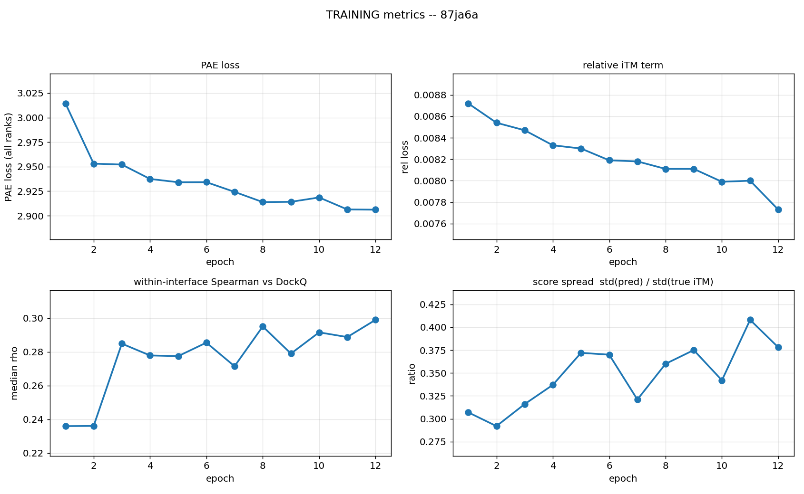
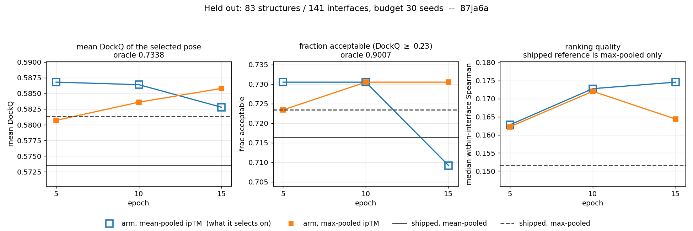

# 87ja6a — live results

Chain `87ja6a`. lr 0.001, 20 epochs, eval every 5.

Regenerated at each epoch boundary. Checkpoints, run logs and trajectories are not in the repo; these are the numbers and the figures.

## Training

| epoch | PAE | rel | rho | spread |
|---|---|---|---|---|
| 1 | 3.0144 | 0.0087 | 0.2359 | 0.3070 |
| 2 | 2.9530 | 0.0085 | 0.2360 | 0.2920 |
| 3 | 2.9521 | 0.0085 | 0.2848 | 0.3160 |
| 4 | 2.9375 | 0.0083 | 0.2778 | 0.3370 |
| 5 | 2.9341 | 0.0083 | 0.2774 | 0.3720 |
| 6 | 2.9342 | 0.0082 | 0.2854 | 0.3700 |
| 7 | 2.9242 | 0.0082 | 0.2714 | 0.3210 |
| 8 | 2.9139 | 0.0081 | 0.2950 | 0.3600 |
| 9 | 2.9141 | 0.0081 | 0.2789 | 0.3750 |
| 10 | 2.9186 | 0.0080 | 0.2915 | 0.3420 |
| 11 | 2.9063 | 0.0080 | 0.2887 | 0.4080 |
| 12 | 2.9061 | 0.0077 | 0.2989 | 0.3780 |

## Held out — 83 structures / 141 interfaces, budget 30

| | mean DockQ | max-pooled | frac acc | rho (mean) | rho (max) |
|---|---|---|---|---|---|
| shipped | 0.5735 | 0.5813 | 0.7163 | — | 0.1515 |
| epoch 10 | 0.5864 | 0.5836 | 0.7305 | 0.1728 | 0.1720 |
| epoch 5 | 0.5868 | 0.5807 | 0.7305 | 0.1628 | 0.1623 |

