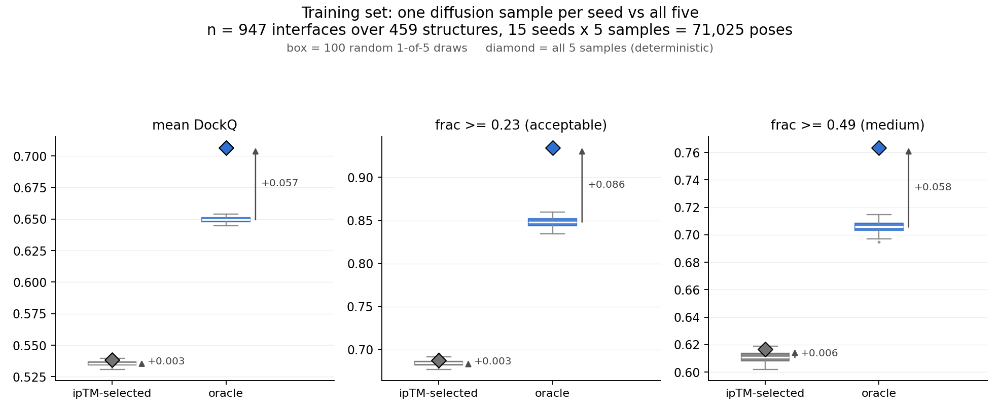
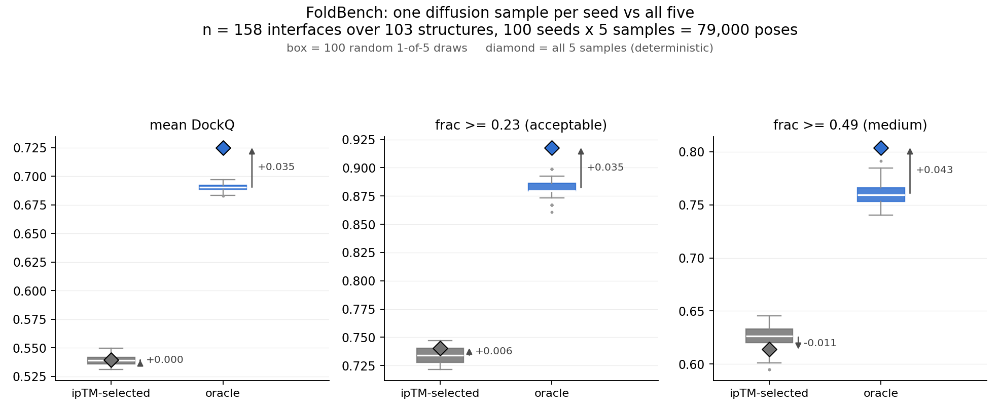
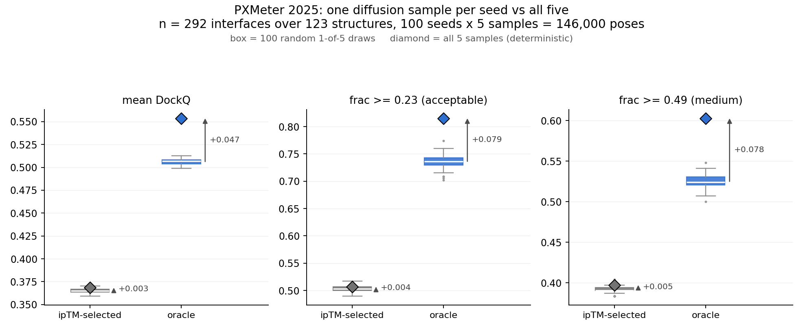

# Depth generates, selection does not deliver

Reproduce every panel with `run_logging/fig1_depth_vs_selection.py`:

```
python -I run_logging/fig1_depth_vs_selection.py \
    --label "Training set" --out figures/paper/fig1_train.png
python -I run_logging/fig1_depth_vs_selection.py --seeds 100 \
    --results ../experimental_data/protenix/foldbench/foldbench_baseline_results.csv \
    --label "FoldBench" --out figures/paper/fig1_foldbench.png
python -I run_logging/fig1_depth_vs_selection.py --seeds 100 \
    --results ../experimental_data/protenix/pxm2025/pxm2025_baseline_results.csv \
    --label "PXMeter 2025" --out figures/paper/fig1_pxm.png
```

Box = 100 random draws of one sample per seed. Diamond = all five samples, which is
deterministic and so is not resampled. Interfaces are truncated to a common seed count and any
seed without a complete set of five samples is dropped.

## Figure 1a — Training set



n = 947 interfaces over 459 structures, 15 seeds x 5 samples = 71,025 poses.

| metric | 1-of-5, ipTM | all-5, ipTM | Δ | 1-of-5, oracle | all-5, oracle | Δ | converted |
|---|---|---|---|---|---|---|---|
| mean DockQ | 0.5355 | 0.5383 | +0.0028 | 0.6495 | 0.7066 | +0.0571 | 4.9% |
| frac ≥ 0.23 | 0.6847 | 0.6874 | +0.0028 | 0.8481 | 0.9345 | +0.0864 | 3.2% |
| frac ≥ 0.49 | 0.6106 | 0.6167 | +0.0061 | 0.7057 | 0.7635 | +0.0578 | 10.5% |

Paired over interfaces, the ipTM mean-DockQ delta is **+0.0028, t = +1.57, p = 0.12** — 472
interfaces improve, 440 get worse.

## Figure 1b — FoldBench



n = 158 interfaces, 100 seeds x 5 samples = 79,000 poses. Two interfaces dropped for carrying a
seed with only four samples.

| metric | 1-of-5, ipTM | all-5, ipTM | Δ | 1-of-5, oracle | all-5, oracle | Δ | converted |
|---|---|---|---|---|---|---|---|
| mean DockQ | 0.5391 | 0.5395 | +0.0004 | 0.6903 | 0.7249 | +0.0346 | 1.2% |
| frac ≥ 0.23 | 0.7342 | 0.7405 | +0.0063 | 0.8823 | 0.9177 | +0.0354 | 17.9% |
| frac ≥ 0.49 | 0.6254 | 0.6139 | **−0.0115** | 0.7608 | 0.8038 | +0.0430 | **−26.6%** |

## Figure 1c — PXMeter 2025



n = 292 interfaces over 123 structures, 100 seeds x 5 samples = 146,000 poses.

| metric | 1-of-5, ipTM | all-5, ipTM | Δ | 1-of-5, oracle | all-5, oracle | Δ | converted |
|---|---|---|---|---|---|---|---|
| mean DockQ | 0.3652 | 0.3685 | +0.0033 | 0.5063 | 0.5536 | +0.0473 | 7.0% |
| frac ≥ 0.23 | 0.5029 | 0.5068 | +0.0040 | 0.7364 | 0.8151 | +0.0787 | 5.0% |
| frac ≥ 0.49 | 0.3918 | 0.3973 | +0.0054 | 0.5250 | 0.6027 | +0.0778 | 7.0% |
