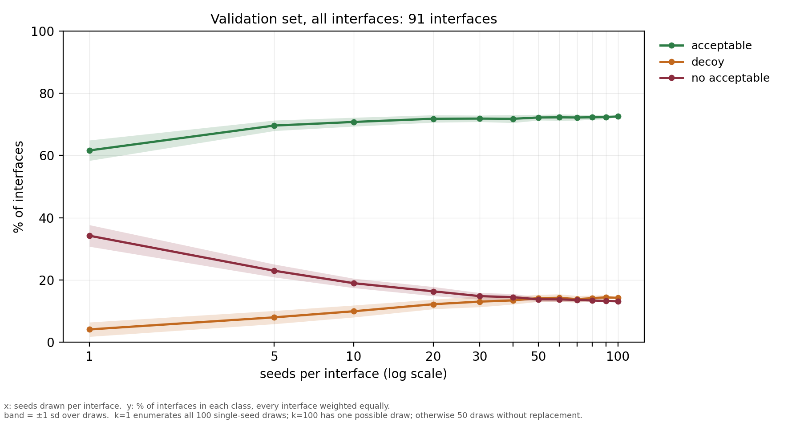
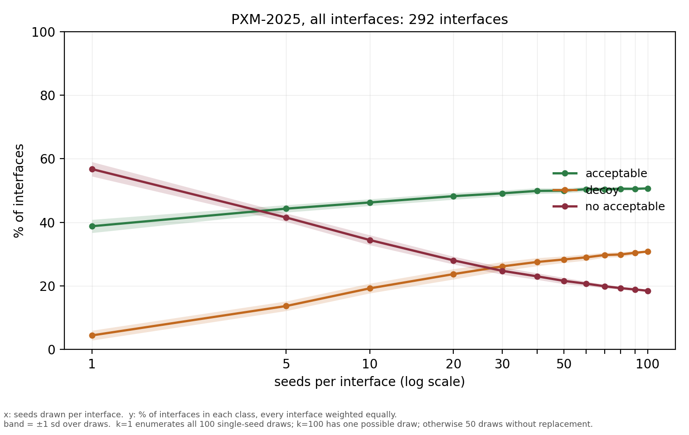

# Seed scaling

Each interface is one of three things at a given seed depth:

| class | definition |
|---|---|
| no acceptable | no pose in the draw reaches DockQ 0.23 |
| decoy | an acceptable pose is in the draw, but the top pair-ipTM pose is below 0.23 |
| acceptable | the top pair-ipTM pose is at or above 0.23 |

## Interface class vs seed depth

x = seeds drawn per interface. y = % of interfaces in each class, every interface weighted equally.
Band = ±1 sd over draws. k=1 enumerates all 100 single-seed draws (the i-th seed of each interface);
k=100 has one possible draw; otherwise 50 draws without replacement, seed 0. Acceptable at
DockQ ≥ 0.23, selection by top pair-ipTM.

Generated by `diffusion_commit_clean_v2/analysis/val_seed_depth_curve.py`. Per-arm figures
(all-new vs mixed) exist in `docs/figures/` and are not reproduced here.

### Validation set, 91 interfaces

| seeds | draws | acceptable | decoy | no acceptable |
|---|---|---|---|---|
| 1 | 100 | 61.6 ± 3.3 | 4.1 ± 2.3 | 34.2 ± 3.5 |
| 5 | 50 | 69.6 ± 1.7 | 8.0 ± 2.1 | 23.0 ± 2.1 |
| 10 | 50 | 70.8 ± 1.4 | 10.0 ± 1.9 | 19.0 ± 1.5 |
| 20 | 50 | 71.8 ± 1.2 | 12.2 ± 1.5 | 16.4 ± 1.5 |
| 30 | 50 | 71.9 ± 1.0 | 13.1 ± 1.7 | 14.8 ± 1.1 |
| 40 | 50 | 71.8 ± 1.3 | 13.5 ± 1.3 | 14.5 ± 1.1 |
| 50 | 50 | 72.2 ± 0.9 | 14.2 ± 1.1 | 13.8 ± 0.7 |
| 60 | 50 | 72.2 ± 1.0 | 14.3 ± 1.2 | 13.8 ± 0.7 |
| 70 | 50 | 72.2 ± 0.9 | 13.9 ± 1.1 | 13.6 ± 0.6 |
| 80 | 50 | 72.3 ± 0.8 | 14.2 ± 0.9 | 13.5 ± 0.5 |
| 90 | 50 | 72.4 ± 0.7 | 14.4 ± 0.7 | 13.3 ± 0.3 |
| 100 | 1 | 72.5 | 14.3 | 13.2 |

### PXM-2025, 292 interfaces

| seeds | draws | acceptable | decoy | no acceptable |
|---|---|---|---|---|
| 1 | 100 | 38.8 ± 2.1 | 4.5 ± 1.5 | 56.8 ± 2.3 |
| 5 | 50 | 44.3 ± 1.2 | 13.7 ± 1.5 | 41.5 ± 1.3 |
| 10 | 50 | 46.3 ± 1.1 | 19.2 ± 1.5 | 34.4 ± 1.6 |
| 20 | 50 | 48.2 ± 1.1 | 23.7 ± 1.6 | 28.1 ± 1.2 |
| 30 | 50 | 49.1 ± 0.9 | 26.2 ± 1.4 | 24.8 ± 1.2 |
| 40 | 50 | 49.9 ± 0.9 | 27.5 ± 1.3 | 23.0 ± 1.0 |
| 50 | 50 | 50.0 ± 0.8 | 28.3 ± 1.0 | 21.6 ± 1.0 |
| 60 | 50 | 50.4 ± 0.8 | 29.0 ± 1.0 | 20.7 ± 0.7 |
| 70 | 50 | 50.3 ± 0.7 | 29.7 ± 0.8 | 19.9 ± 0.6 |
| 80 | 50 | 50.6 ± 0.6 | 29.9 ± 0.8 | 19.3 ± 0.4 |
| 90 | 50 | 50.5 ± 0.4 | 30.4 ± 0.6 | 18.9 ± 0.4 |
| 100 | 1 | 50.7 | 30.8 | 18.5 |
## Queued: both benchmarks to 100 usable seeds

Not launched. Runs after the 40-cluster validation fold and its 13 second representatives.

| | folds | on 3 GPUs | poses |
|---|---|---|---|
| PXM-2025 | 290 (29 already done) | 1.5 h | ~1 GiB |
| FoldBench | 1,554 | 8.9 h | ~4 GiB |

### Why FoldBench costs 6x what PXM does, and what was decided

FoldBench's usable depth is 60 seeds (the 50-seed pool plus `extra10`), because its 151-200 block is
`suspect` in the pooled table. Three policies were priced:

| policy | folds | on 3 GPUs |
|---|---|---|
| (a) ignore the suspect block, fold 40 fresh seeds for all 104 structures | 4,161 | 35.7 h |
| (b) credit the suspect block entirely | 1,192 | 6.3 h |
| **(c) credit it except the 10 disagreeing complexes, which refold** | **1,554** | **8.9 h** |

**(c) was chosen.** The 10 are `8up2 7x8p 8vyl 8oni 7zoz 8be3 8urf 8che 8byu 9fww` -- the complexes
whose suspect block disagrees with the pool at p<0.001 on how often a seed finds an acceptable pose,
in both directions (`8up2_AC` 48/50 -> 23/50, `8vyl_AF` 15/50 -> 0/50). For the other 94 the paired
mean DockQ matches to 0.007, so crediting them is sound; (a) would spend 27 extra GPU-hours
re-deriving seeds we already have, and (b) would carry the disagreement into coverage counts, which
are max-over-seeds statistics and therefore exactly what it moves.

### How to launch

    cd diffusion_commit_clean_v2
    # foldbench queue already written by:
    python3 build_topup_queue.py --dataset foldbench --credit-suspect-except-flagged --seed0 600000 --apply
    # -> experimental_data/protenix/foldbench/free_top100/queue.tsv, seeds 600000-600039, 1554 folds

    # then one worker per card, e.g.
    tmux new-session -d -s fb_top100_0 "cd ~/Protenix && CUDA_VISIBLE_DEVICES=0 LAYERNORM_TYPE=openfold \
      ~/Protenix/.venv/bin/python ~/tts_abag/diffusion_commit_clean_v2/folder.py \
      --queue <arm>/queue.tsv --out <arm>/poses --csv <arm>/results.csv --claim-dir <arm>/claims \
      --dataset foldbench --ncycle 10 --nsample 5 --dtype bf16 --overlap-scoring >> <arm>/w0.log 2>&1"

Workers share one queue through the claim directory, so three on one queue is the normal pattern.

**PXM resumes its existing arm, it is not regenerated.** `pxm2025/free_top100/queue.tsv` already
holds the right 290 folds at seeds 300601+ with 29 done; running the generator for pxm would allocate
310000+ and discard that work.

**FoldBench folds template-free.** `paths.DATASETS['foldbench'].free_templates = False`, matching the
pool its seeds join; `--dataset foldbench` enforces it. PXM folds with templates. Mixing the two
within a benchmark's pool would be a settings inconsistency of exactly the kind the `tier` column
exists to catch.

After both finish: rerun `build_free_pool.py --apply`, confirm every interface reaches 100 usable
seeds, and regenerate the tables above with `analysis/seed_depth_split.py --boots 30` -- for FoldBench
at `--universe 100` rather than 60.

## Provenance

| | |
|---|---|
| pooled score tables | `paths.DATASETS[ds].free_pool`, rows with `tier != "suspect"` |
| figures and curves | `diffusion_commit_clean_v2/analysis/val_seed_depth_curve.py` |
| benchmark top-up queues | `diffusion_commit_clean_v2/build_topup_queue.py` |

`tier != "suspect"` excludes FoldBench's 151-200 seed block for 10 complexes: 16 interfaces disagree
with the pool at p<0.001 on how often a seed finds an acceptable pose, in both directions. See each
benchmark's `free_pool/INDEX.md`.

