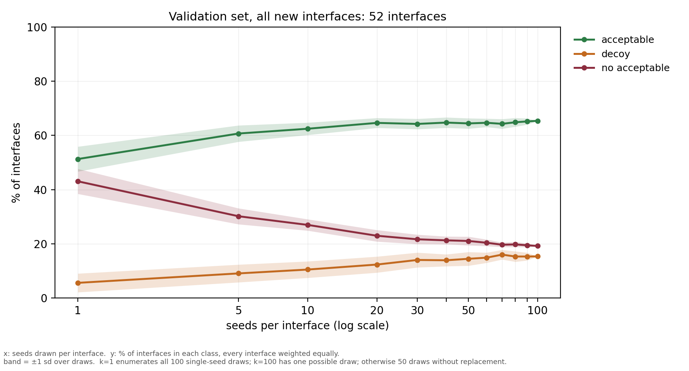
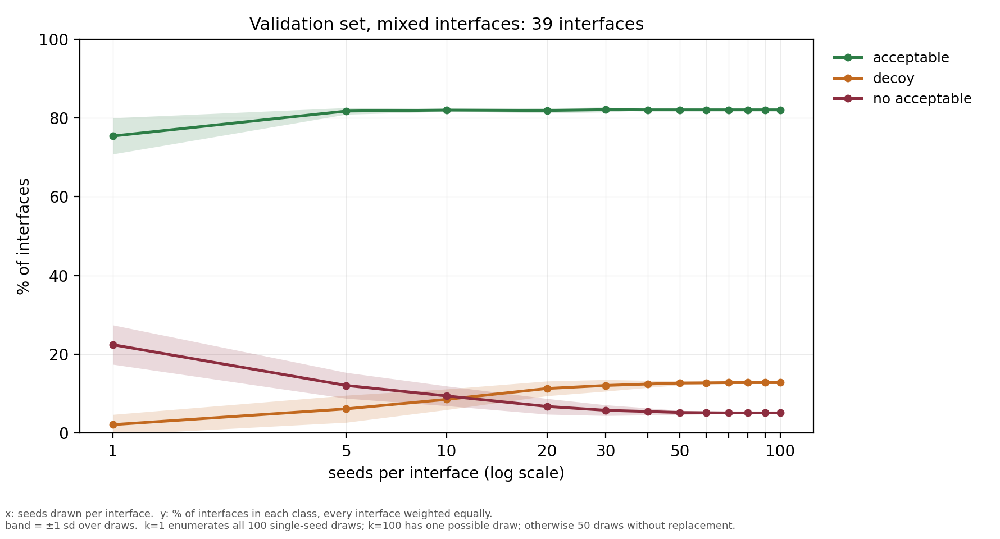

# What seed scaling buys, by benchmark

Measured 2026-10-12. Each interface is one of three things at a given seed depth:

- **no acceptable** — no pose in the draw reaches DockQ 0.23. A *sampling* failure; reranking these
  poses cannot fix it.
- **decoy** — an acceptable pose is in the draw, but top pair-ipTM picks one below 0.23. A
  *selection* failure, winnable with no extra folding.
- **acceptable** — top pair-ipTM picks an acceptable pose.

Cells are interface counts, mean ± sd over 30 bootstrap draws of that many seeds, drawn without
replacement from each interface's own seed universe. The last row of each table is the single
possible draw, so it has no spread. Every interface contributes exactly the same number of seeds, so
each column is the same experiment across interfaces.

## PXM-2025 — 274 interfaces, universe of 100 seeds

| seeds | decoy | acceptable | no acceptable |
|---|---|---|---|
| 10 | 52.3 ± 4.9 | 121.0 ± 3.3 | 100.7 ± 4.8 |
| 20 | 65.0 ± 4.4 | 126.0 ± 2.4 | 83.0 ± 3.8 |
| 30 | 71.1 ± 4.6 | 129.5 ± 3.3 | 73.4 ± 2.5 |
| 40 | 75.5 ± 3.2 | 130.9 ± 1.7 | 67.6 ± 3.0 |
| 50 | 78.1 ± 2.7 | 132.6 ± 2.2 | 63.3 ± 1.9 |
| 60 | 79.8 ± 3.1 | 133.6 ± 2.5 | 60.6 ± 1.6 |
| 70 | 81.6 ± 3.1 | 134.1 ± 2.1 | 58.2 ± 2.0 |
| 80 | 83.1 ± 2.2 | 134.3 ± 1.4 | 56.6 ± 1.5 |
| 90 | 84.8 ± 1.4 | 133.8 ± 1.0 | 55.4 ± 1.1 |
| 100 | 86.0 | 134.0 | 54.0 |

18 of 292 interfaces are excluded for holding fewer than 100 usable seeds.

## FoldBench — 159 interfaces, universe of 60 seeds

| seeds | decoy | acceptable | no acceptable |
|---|---|---|---|
| 10 | 25.1 ± 3.3 | 105.3 ± 2.4 | 28.6 ± 2.5 |
| 20 | 25.2 ± 2.7 | 111.3 ± 2.4 | 22.4 ± 1.8 |
| 30 | 26.1 ± 2.8 | 114.1 ± 2.4 | 18.8 ± 1.7 |
| 40 | 25.9 ± 2.5 | 116.6 ± 2.1 | 16.5 ± 1.8 |
| 50 | 26.0 ± 1.6 | 118.2 ± 1.3 | 14.8 ± 1.2 |
| 60 | 27.0 | 119.0 | 13.0 |

1 of 160 interfaces is excluded for holding 59 usable seeds. FoldBench stops at 60 because that is
all the depth it has at settings comparable to its published baseline.

## What the two tables say together

Seed scaling reliably reduces the no-acceptable count on both benchmarks, and the decoy count rises
or stays flat — it never falls. Selection then decides whether a rescued interface is actually won:

| | no-acceptable rescued | of those, became acceptable | conversion |
|---|---|---|---|
| PXM-2025, 10 -> 100 seeds | 46.7 | 13.0 | **28%** |
| FoldBench, 10 -> 60 seeds | 15.6 | 13.7 | **88%** |

Same intervention, opposite bottleneck. FoldBench's ceiling is sampling: it keeps nearly everything
scaling finds. PXM's is selection: 34 of the 47 interfaces that gained a good pose land in the decoy
column, where no further folding helps and only reranking can.

This is also why the decoy count, not the acceptable count, is the metric to watch. Past 50 seeds
PXM's acceptable count is flat inside its own noise (132.6 ± 2.2 -> 134.0) while the recoverable
pool grows from 78 to 86 interfaces.

## Provenance

| | |
|---|---|
| table generator | `diffusion_commit_clean_v2/analysis/seed_depth_split.py` |
| data | `paths.DATASETS[ds].free_pool`, rows with `tier != "suspect"` |
| commands | `seed_depth_split.py --dataset pxm2025 --boots 30` `seed_depth_split.py --dataset foldbench --depths 10,20,30,40,50,60 --universe 60 --boots 30` |

`tier != "suspect"` excludes FoldBench's 151-200 seed block: 16 interfaces over 10 complexes
disagree with the pool on how often a seed finds an acceptable pose, at p<0.001 and in both
directions. These are max-over-seeds statistics, which is exactly what such a disagreement moves.
See each benchmark's `free_pool/INDEX.md`.

## Queued: both benchmarks to 100 usable seeds

Not launched. Runs after the 40-cluster validation fold and its 13 second representatives.

| | folds | on 3 GPUs | poses |
|---|---|---|---|
| PXM-2025 | 290 (29 already done) | 1.5 h | ~1 GiB |
| FoldBench | 1,554 | 8.9 h | ~4 GiB |

### Why FoldBench costs 6x what PXM does, and what was decided

FoldBench's usable depth is 60 seeds (the 50-seed pool plus `extra10`), because its 151-200 block is
`suspect` in the pooled table. Three policies were priced:

| policy | folds | on 3 GPUs |
|---|---|---|
| (a) ignore the suspect block, fold 40 fresh seeds for all 104 structures | 4,161 | 35.7 h |
| (b) credit the suspect block entirely | 1,192 | 6.3 h |
| **(c) credit it except the 10 disagreeing complexes, which refold** | **1,554** | **8.9 h** |

**(c) was chosen.** The 10 are `8up2 7x8p 8vyl 8oni 7zoz 8be3 8urf 8che 8byu 9fww` -- the complexes
whose suspect block disagrees with the pool at p<0.001 on how often a seed finds an acceptable pose,
in both directions (`8up2_AC` 48/50 -> 23/50, `8vyl_AF` 15/50 -> 0/50). For the other 94 the paired
mean DockQ matches to 0.007, so crediting them is sound; (a) would spend 27 extra GPU-hours
re-deriving seeds we already have, and (b) would carry the disagreement into coverage counts, which
are max-over-seeds statistics and therefore exactly what it moves.

### How to launch

    cd diffusion_commit_clean_v2
    # foldbench queue already written by:
    python3 build_topup_queue.py --dataset foldbench --credit-suspect-except-flagged --seed0 600000 --apply
    # -> experimental_data/protenix/foldbench/free_top100/queue.tsv, seeds 600000-600039, 1554 folds

    # then one worker per card, e.g.
    tmux new-session -d -s fb_top100_0 "cd ~/Protenix && CUDA_VISIBLE_DEVICES=0 LAYERNORM_TYPE=openfold \
      ~/Protenix/.venv/bin/python ~/tts_abag/diffusion_commit_clean_v2/folder.py \
      --queue <arm>/queue.tsv --out <arm>/poses --csv <arm>/results.csv --claim-dir <arm>/claims \
      --dataset foldbench --ncycle 10 --nsample 5 --dtype bf16 --overlap-scoring >> <arm>/w0.log 2>&1"

Workers share one queue through the claim directory, so three on one queue is the normal pattern.

**PXM resumes its existing arm, it is not regenerated.** `pxm2025/free_top100/queue.tsv` already
holds the right 290 folds at seeds 300601+ with 29 done; running the generator for pxm would allocate
310000+ and discard that work.

**FoldBench folds template-free.** `paths.DATASETS['foldbench'].free_templates = False`, matching the
pool its seeds join; `--dataset foldbench` enforces it. PXM folds with templates. Mixing the two
within a benchmark's pool would be a settings inconsistency of exactly the kind the `tier` column
exists to catch.

After both finish: rerun `build_free_pool.py --apply`, confirm every interface reaches 100 usable
seeds, and regenerate the tables above with `analysis/seed_depth_split.py --boots 30` -- for FoldBench
at `--universe 100` rather than 60.

## Validation set: interface class vs seed depth

Generated by `diffusion_commit_clean_v2/analysis/val_seed_depth_curve.py`; numbers in the matching
`.csv` beside each figure.

**All 40 clusters, 91 interfaces**

**All-new clusters only, 24 clusters, 52 interfaces**

**Mixed clusters only, 16 clusters, 39 interfaces**

x = seeds drawn per interface. y = % of interfaces in each class, computed within each cluster then
averaged over clusters with equal weight. Band = ±1 sd over draws. k=1 enumerates all 100 single-seed
draws; k=100 has one possible draw; otherwise 50 draws without replacement, seed 0. Acceptable at
DockQ ≥ 0.23, selection by top pair-ipTM.

### All 40 clusters, 91 interfaces

| seeds | draws | acceptable | decoy | no acceptable |
|---|---|---|---|---|
| 1 | 100 | 57.5 ± 3.3 | 3.8 ± 2.3 | 38.6 ± 3.7 |
| 5 | 50 | 65.5 ± 1.4 | 8.1 ± 2.4 | 26.2 ± 2.5 |
| 10 | 50 | 66.7 ± 1.5 | 11.1 ± 3.3 | 22.0 ± 2.4 |
| 20 | 50 | 67.3 ± 1.6 | 13.8 ± 2.3 | 18.5 ± 1.9 |
| 30 | 50 | 67.8 ± 1.4 | 15.2 ± 2.1 | 16.6 ± 1.5 |
| 40 | 50 | 67.6 ± 1.3 | 15.8 ± 1.4 | 15.7 ± 1.0 |
| 50 | 50 | 68.0 ± 1.3 | 16.3 ± 1.6 | 15.5 ± 1.0 |
| 60 | 50 | 68.0 ± 1.0 | 16.6 ± 1.3 | 15.4 ± 0.7 |
| 70 | 50 | 68.0 ± 1.1 | 16.6 ± 1.2 | 15.3 ± 0.9 |
| 80 | 50 | 68.2 ± 0.8 | 16.9 ± 1.1 | 14.8 ± 0.5 |
| 90 | 50 | 68.3 ± 0.5 | 16.6 ± 0.7 | 14.7 ± 0.3 |
| 100 | 1 | 68.5 | 16.9 | 14.6 |

### All-new clusters only, 24 clusters, 52 interfaces

| seeds | draws | acceptable | decoy | no acceptable |
|---|---|---|---|---|
| 1 | 100 | 46.1 ± 4.4 | 4.9 ± 3.2 | 49.0 ± 4.8 |
| 5 | 50 | 54.3 ± 2.7 | 10.5 ± 3.4 | 34.6 ± 4.2 |
| 10 | 50 | 56.0 ± 2.7 | 13.2 ± 4.4 | 31.1 ± 3.4 |
| 20 | 50 | 57.7 ± 2.0 | 16.8 ± 3.7 | 25.1 ± 3.0 |
| 30 | 50 | 58.2 ± 2.5 | 18.6 ± 3.7 | 23.3 ± 2.3 |
| 40 | 50 | 58.1 ± 2.2 | 19.8 ± 3.0 | 22.2 ± 1.5 |
| 50 | 50 | 57.9 ± 1.7 | 19.8 ± 2.2 | 22.0 ± 1.4 |
| 60 | 50 | 58.0 ± 1.6 | 19.6 ± 1.9 | 21.3 ± 1.2 |
| 70 | 50 | 58.1 ± 1.7 | 20.7 ± 2.2 | 21.0 ± 1.3 |
| 80 | 50 | 58.5 ± 1.6 | 20.8 ± 1.4 | 20.6 ± 0.9 |
| 90 | 50 | 58.8 ± 1.0 | 21.0 ± 1.5 | 20.4 ± 0.7 |
| 100 | 1 | 59.0 | 20.8 | 20.1 |
